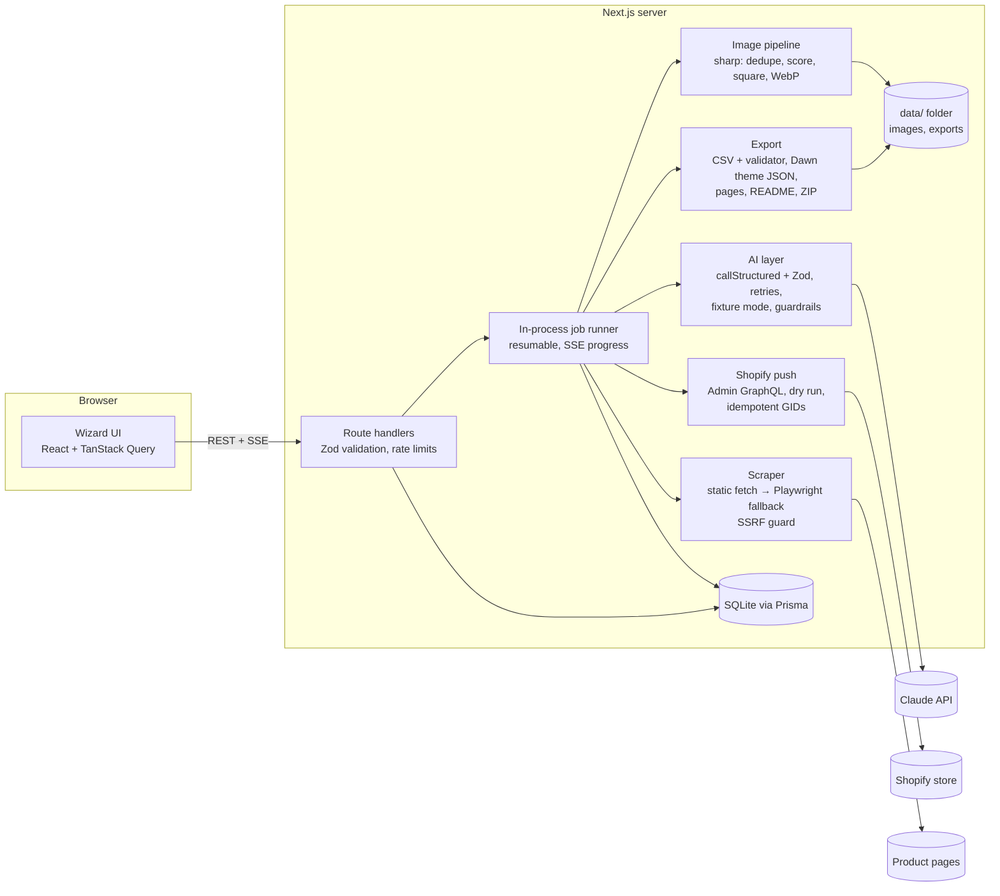

# StoreForge

Turn a product (a supplier or competitor URL, or just your own photos) into a ready-to-launch
Shopify store: product analysis with risk flags, a brand kit with logo, an original listing with
pricing and variants, cleaned images, homepage and policy content, and either a ZIP bundle for
Shopify's importers or a direct push through the Shopify Admin API.

StoreForge drafts; you decide. Nothing is published to a live store automatically, it never
invents reviews, ratings, urgency or medical claims, and it doesn't verify supplier reliability,
product safety, or regulatory compliance.

## Quick start

Requirements: Node.js 22.12 or newer.

```bash
npm install
npm run dev          # http://localhost:3000
```

`npm install` generates the Prisma client; `npm run dev` creates the SQLite database in `data/`
on first run. Without an API key the app still opens, and tells you AI steps need
`ANTHROPIC_API_KEY`. To try every step offline with deterministic sample output:

```bash
AI_MODE=fixture npm run dev
```

Copy `.env.example` to `.env.local` to configure it (see below).

### Other commands

| Command                                   | What it does                                                     |
| ----------------------------------------- | ---------------------------------------------------------------- |
| `npm run build` / `npm start`             | Production build and server                                      |
| `npm run lint`                            | ESLint                                                           |
| `npm run typecheck`                       | `tsc --noEmit` (after `next typegen`)                            |
| `npm test`                                | Unit and integration tests (Vitest, fixture AI mode, temp DB)    |
| `npm run test:e2e`                        | Browser test: fixture product page and photos → ZIP (Playwright) |
| `npx tsx tests/support/fixture-server.ts` | Serve the fixture product site on http://127.0.0.1:4555          |

For the end-to-end test, Playwright needs a Chromium. If one is installed somewhere other than
Playwright's default location, point at it: `CHROMIUM_PATH=/path/to/chromium npm run test:e2e`.

## Environment variables

| Variable                     | Default                        | Purpose                                                                                                              |
| ---------------------------- | ------------------------------ | -------------------------------------------------------------------------------------------------------------------- |
| `ANTHROPIC_API_KEY`          | (none)                         | Claude API key for analysis, branding, copy and vision. Without it (and without fixture mode) AI steps are disabled. |
| `ANTHROPIC_MODEL`            | `claude-sonnet-5-5`            | Model used for generation.                                                                                           |
| `AI_MODE`                    | `live`                         | `fixture` returns deterministic offline output (demos and tests).                                                    |
| `APP_BASE_URL`               | `http://localhost:3000`        | Public address of the app; used for public image links.                                                              |
| `PUBLIC_IMAGE_BASE_URL`      | (none)                         | Where you host exported images yourself for "Public URL mode" CSVs.                                                  |
| `SHOPIFY_STORE_DOMAIN`       | (none)                         | Optional default store for "Push to Shopify", e.g. `my-store.myshopify.com`.                                         |
| `SHOPIFY_ADMIN_ACCESS_TOKEN` | (none)                         | Optional Admin API token for that store. You can instead enter one in the app for the current session only.          |
| `SHOPIFY_API_VERSION`        | `2026-10`                      | Admin GraphQL API version.                                                                                           |
| `SHOPIFY_THEME_SOURCE_URL`   | Dawn v16.0.0 archive on GitHub | ZIP used when the push creates a new unpublished Dawn theme.                                                         |
| `SESSION_SECRET`             | random per process             | 32+ characters; encrypts the session-only Shopify token cookie. Unset means tokens are forgotten on restart.         |
| `REMOVE_BG_PROVIDER`         | `none`                         | `removebg` or `photoroom` for optional background removal.                                                           |
| `REMOVE_BG_API_KEY`          | (none)                         | Key for that provider.                                                                                               |
| `MAX_UPLOAD_MB`              | `15`                           | Per-image upload limit.                                                                                              |
| `DATABASE_URL`               | `file:./data/storeforge.db`    | SQLite database.                                                                                                     |
| `DATA_DIR`                   | `data`                         | Uploaded images, processed images and exports.                                                                       |
| `DATA_RETENTION_DAYS`        | `30`                           | Projects older than this are deleted (at startup and daily).                                                         |
| `SCRAPE_ALLOWLIST`           | (empty)                        | `host:port` pairs the scraper may fetch even though they're private. For local fixtures only.                        |
| `FONT_DOWNLOADS`             | `on`                           | Download Google Fonts to draw the logo wordmark as outlines; `off` uses live SVG text.                               |

## How it works

The wizard has seven steps: **Input → Product analysis → Brand kit → Product listing → Images →
Store content → Export**. Each step runs as a background job with live progress over
Server-Sent Events, and "Generate everything" runs them all in order.



- **Schemas first:** Zod schemas in `src/lib/schemas` are the source of truth for data, API
  bodies and AI output; Prisma stores them as JSON columns.
- **The model writes words, code decides structure:** handles, menus, variant matrices, SEO
  lengths, prices and Shopify formats are produced in code; model output is validated and sent
  back with the errors when it doesn't fit.
- **Guardrails:** every generated text is scanned for fabricated reviews or ratings, urgency,
  medical claims, unverifiable credentials and supplier mentions before it's saved.
- See `DECISIONS.md` for every non-obvious choice.

## Exporting to Shopify

### ZIP bundle

The export step builds a ZIP with the product CSV (Shopify's current column names, or the
classic ones), images, image mapping, pages and policies as HTML, collections, menus, Dawn theme
JSON, brand kit, a placeholders list, a validation report and `README-IMPORT-STEPS.md`, which walks
through the import click by click.

### Push to Shopify (Admin API)

The push creates the product as a **draft** (with images, variants and inventory), smart
collections, hidden pages, store policies and menus, and optionally writes the theme files to an
**unpublished** theme. Run a dry run first: it checks the connection and lists every operation,
and the push itself asks you to confirm the store. Re-pushing updates what it created before
instead of duplicating it. A failed step can be retried on its own.

#### Create a custom app and get an Admin API access token

1. In your Shopify admin, open **Settings → Apps and sales channels → Develop apps**. If asked,
   click **Allow custom app development**.
2. Click **Create an app**, name it (e.g. "StoreForge") and choose yourself as the developer.
3. Open **Configuration → Admin API integration → Configure** and select these scopes:
   `write_products, read_products, write_files, read_files, write_content, read_content,
write_online_store_navigation, read_online_store_navigation, write_themes, read_themes,
write_inventory`. To write **Settings → Policies** directly, also select
   `read_legal_policies, write_legal_policies`; without them, policies are created as hidden
   pages instead.
4. Save, then open **API credentials → Install app**.
5. Under **Admin API access token**, click **Reveal token once** and copy it (it starts with
   `shpat_`).
6. In StoreForge's export step, enter your `*.myshopify.com` address and the token (kept for
   this browser session only), or set `SHOPIFY_STORE_DOMAIN` and `SHOPIFY_ADMIN_ACCESS_TOKEN`.

Tokens are never written to disk in plain text or logged: a token typed into the app lives in
an AES-256-GCM encrypted, httpOnly cookie and in server memory while a push runs.

## Known limitations

- **Shopify CSV template:** Shopify renamed its product CSV columns; the current names come from
  the Help Center's "Using CSV files" page (checked 2026-10-15) because the template file itself
  couldn't be downloaded while building this. Shopify says the classic names still import, and
  the export step offers both. If an import asks you to choose column headings, switch format.
- **API version:** `2026-10` was the newest stable Admin API version on 2026-10-15 and the push
  was written against its schema. Shopify retires versions after about a year; update
  `SHOPIFY_API_VERSION` and re-run the tests when you move.
- **The push was tested against a mock of the Admin API**, not a live store. Mutation names and
  input shapes were checked against Shopify's published schema.
- **New Dawn theme from GitHub:** creating a theme from Dawn's GitHub archive depends on Shopify
  accepting that ZIP layout. If it fails, duplicate Dawn in your admin and pick that copy.
- **Public URL mode on localhost** can't work: Shopify must reach the image URLs. Deploy the app,
  use a tunnel, set `PUBLIC_IMAGE_BASE_URL`, upload images after import, or push directly.
- **Smart collections** pick up the product only if its tags or type match their rules; the push
  says when they don't.
- **Policies are templates, not legal advice.** Fill every placeholder and have counsel review.
- **Scraping:** sites behind bot protection, CAPTCHAs, logins or paywalls aren't scraped; upload
  photos and details instead.
- **Single process:** the job runner, rate limiter and token hand-off live in one Node process.
  Running several instances needs a shared queue and store.
- StoreForge doesn't verify supplier reliability, product safety, or regulatory compliance.
